# From Home To Home (من البيت للبيت) — Architecture

| Field | Value |
|---|---|
| Version | v1.1 |
| Date | 2026-10-18 |
| Owner | Rana |
| Status | Draft |
| Source of scope | [docs/PRD.md](PRD.md) (sections 8, 9 and 11) |

This document describes how the MVP is built: the runtime pieces, how they are deployed, how the backend is layered, how the order lifecycle and delivery acceptance work, and how the repository is organized. It covers architecture and structure only; it contains no implementation code.

## 1. Architectural Principles

1. **One frontend, one API, one database.** A single Angular SPA talks to a single ASP.NET Core API, which owns a single PostgreSQL database. No microservices, no message queues, no background workers in v1.
2. **The backend owns every rule.** Prices, totals, permissions and status transitions are decided on the server. The UI only renders the actions the server would allow.
3. **One state machine for orders.** Every status change goes through `OrderStateMachine` in the application layer. No other code writes `Order.Status`.
4. **Correctness through the database.** Exclusive delivery acceptance and idempotent order placement are enforced with PostgreSQL transactions, row locks, conditional updates and unique constraints, not with in-process locks.
5. **Stateless API.** No session state lives in the API process, so Railway can run more than one instance behind its load balancer. Shared state lives in PostgreSQL (data) and Redis (rate limits, cache).
6. **Polling over push.** Order status and notifications refresh by polling (15 seconds), which keeps the MVP free of WebSockets and SignalR.

## 2. System Context

Who uses the system and which external services it depends on.

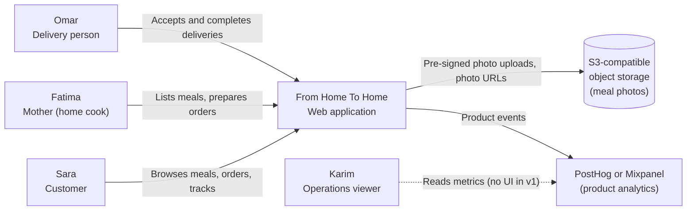

Out of the system boundary in v1: payment gateways, maps, SMS and email providers, and any admin interface.

## 3. Containers and Deployment

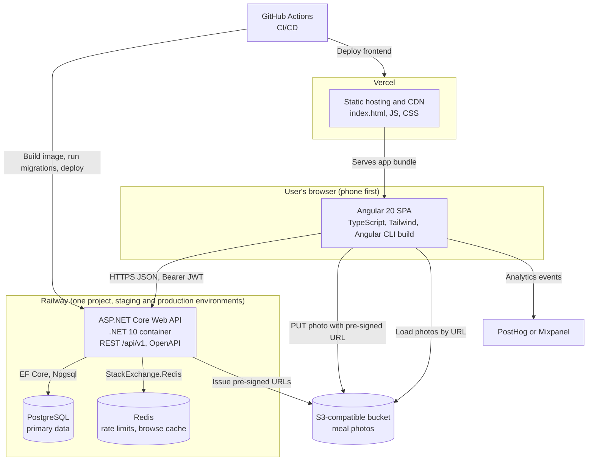

| Container | Technology | Hosting | Responsibility |
|---|---|---|---|
| Web app | Angular 20, TypeScript, Tailwind CSS, Angular CLI (esbuild) | Vercel | Role-based screens, forms, cart, polling of order status and notifications |
| API | .NET 10, C#, ASP.NET Core Web API, EF Core | Railway (Docker container) | Authentication, authorization, business rules, state machine, REST API |
| Database | PostgreSQL | Railway | All persistent data; daily backups, 30-day retention |
| Cache | Redis | Railway | Login rate limiting, request rate limiting, short-lived browse cache |
| Photo storage | S3-compatible bucket (for example Cloudflare R2 or AWS S3) | Managed provider | Meal photos uploaded directly from the browser |
| Analytics | PostHog or Mixpanel | SaaS | Activation, funnel and order-completion events |

### Environments

| Environment | Frontend | API, PostgreSQL, Redis | Photos | Deployed when |
|---|---|---|---|---|
| Local | `ng serve` on port 4200, proxying `/api` to the API on port 5080 | `dotnet run` plus Docker Compose (PostgreSQL, Redis, MinIO) | MinIO container | Developer machine |
| Staging | Vercel preview and staging domain | Railway staging environment | Staging bucket | Every merge to the default branch |
| Production | Vercel production domain | Railway production environment | Production bucket | Manual promotion after staging validation |

Configuration and secrets (connection strings, JWT signing key, bucket credentials, `DELIVERY_FEE_MINOR`, `CURRENCY`, allowed CORS origin) are environment variables on Vercel and Railway and are never committed.

## 4. Backend Architecture

The API is one ASP.NET Core project hosting controllers, backed by three class libraries. Dependencies point inward: `Api → Application → Domain`, and `Infrastructure` implements interfaces declared in `Application`.

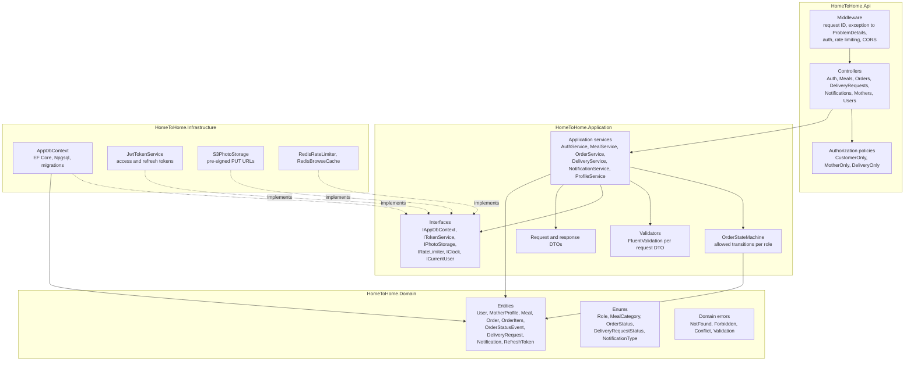

### Layer responsibilities

| Layer | Contains | Must not contain |
|---|---|---|
| Api | Controllers (thin: map HTTP to a service call), middleware, authorization policies, OpenAPI setup, DI composition root (`Program.cs`) | Business rules, EF Core queries |
| Application | Services with the use cases, `OrderStateMachine`, validators, DTOs, interfaces for infrastructure, ownership checks | HTTP types, EF Core provider specifics, S3 or Redis clients |
| Domain | Entities, enums, value rules that need no I/O (for example total calculation), domain error types | Any framework dependency |
| Infrastructure | `AppDbContext`, entity configurations, migrations, JWT, S3, Redis implementations | Business decisions |

A deliberate simplification: services use `IAppDbContext` (EF Core `DbSet`s) directly instead of a repository per entity. EF Core already is a unit of work and repository, and an extra layer adds code without adding safety in an MVP.

### Request pipeline

Every request passes through, in order: request ID and structured JSON logging → global exception handler (maps domain errors to RFC 7807 ProblemDetails) → CORS (Vercel origin only) → JWT bearer authentication → rate limiter → authorization policy → controller → application service → `AppDbContext`.

| Domain error | HTTP status | Example |
|---|---|---|
| Validation | 422 | Price ≤ 0, name shorter than 3 characters |
| Unauthenticated | 401 | Missing or expired access token |
| Forbidden | 403 | A customer calls a mother endpoint; a user opens another user's order |
| NotFound | 404 | Unknown meal or order ID |
| Conflict | 409 | Email already registered; delivery already taken; invalid status transition; unavailable meal at checkout |
| RateLimited | 429 | Sixth failed login within 15 minutes |

## 5. Frontend Architecture

A single Angular 20 SPA built with the Angular CLI (esbuild application builder) and routes grouped by role. Every component is standalone and uses `OnPush` change detection; component and service state lives in signals. Server data is loaded with `HttpClient` through small per-feature API services; polling screens use an RxJS `timer(0, 15000)` piped through `switchMap`, exposed to templates with `toSignal`, which gives the 15-second refresh the PRD requires without a client cache library.

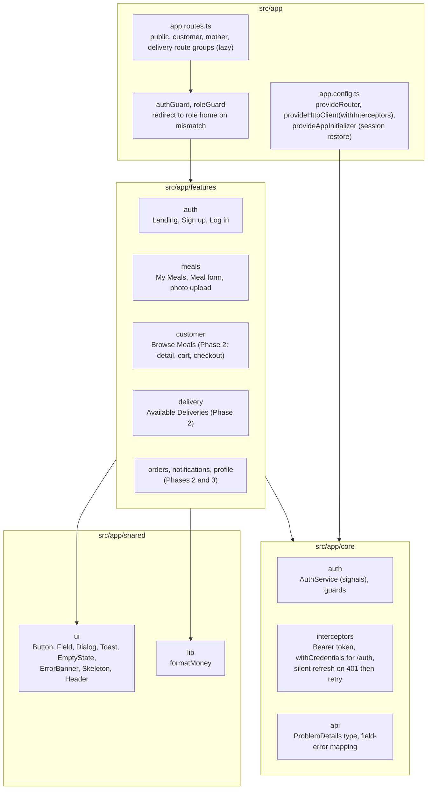

| Concern | Decision |
|---|---|
| Framework | Angular 20, standalone components only, signals for state, built-in control flow (`@if`, `@for`), `OnPush` everywhere |
| Routing | Angular Router with lazy-loaded route groups per role; `roleGuard` sends a user to their role home (customer → Browse Meals, mother → My Meals, delivery → Available Deliveries) |
| Server state | Per-feature services over `HttpClient`; polling with RxJS `timer` + `switchMap` (15 s for order detail, incoming orders, available deliveries and notifications) bridged to templates with `toSignal` |
| Auth tokens | Access token kept in memory in `AuthService`; refresh token in an `HttpOnly`, `Secure`, `SameSite=None` cookie scoped to `/api/v1/auth`; a functional HTTP interceptor refreshes once on 401 and retries; `provideAppInitializer` restores the session on load |
| Cart | Signal-based `CartService` persisted to `localStorage`; holds meals from one mother only; prices re-checked by the server at checkout (Phase 2) |
| Forms | Typed reactive forms with inline validators mirroring the server rules; server 422 `errors` are mapped onto the matching form controls; the server remains the authority |
| Styling | Tailwind CSS with shared tokens for status colors so each status looks the same in every role's view |
| Feedback | Every server action disables its control and shows a spinner; every success shows a toast; every failure shows a banner with Retry |
| Testing | Karma and Jasmine with headless Chrome through the Angular CLI (`ng test`); ESLint through `angular-eslint`; Prettier |
| Analytics | A thin `track(event, props)` wrapper around the PostHog or Mixpanel SDK (Phase 4) |

## 6. Authentication and Authorization

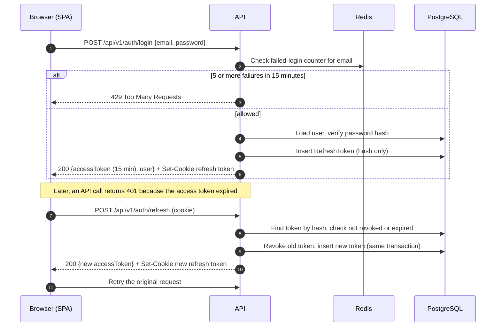

- **Tokens.** Access tokens are JWTs signed with HMAC-SHA256, 15-minute lifetime, carrying `sub` (user ID) and `role` (`CUSTOMER`, `MOTHER`, `DELIVERY`). Refresh tokens are random 256-bit values stored only as SHA-256 hashes; each use revokes the old token and issues a new one. Reuse of a revoked token revokes all of that user's refresh tokens.
- **Passwords.** Hashed with the ASP.NET Core `PasswordHasher`; never logged or returned.
- **Role checks.** Authorization policies on controllers: `CustomerOnly`, `MotherOnly`, `DeliveryOnly`.
- **Ownership checks.** Done in application services, because they need data: a mother edits only meals where `Meal.MotherId` equals her ID; an order is readable only by its customer, its mother and its assigned delivery person.
- **Contact privacy.** The customer's full address and phone are returned to a delivery person only after that person has accepted the request; before acceptance, only the area is shown.

## 7. Order Lifecycle (State Machine)

`OrderStateMachine` is the only component allowed to change `Order.Status`. Each transition records an `OrderStatusEvent` and the related notifications in the same database transaction.

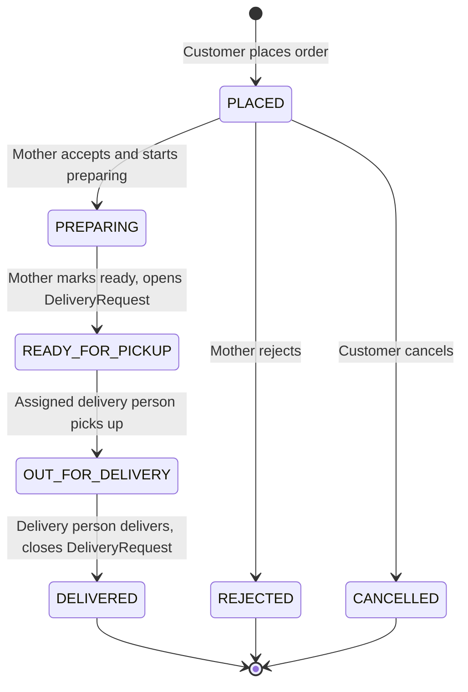

| From | To | Allowed actor | Side effects in the same transaction |
|---|---|---|---|
| PLACED | PREPARING | The order's mother | Status event; notify customer |
| PLACED | REJECTED | The order's mother | Status event; notify customer |
| PLACED | CANCELLED | The order's customer | Status event; notify mother |
| PREPARING | READY_FOR_PICKUP | The order's mother | Status event; create one `DeliveryRequest` (OPEN); notify customer |
| READY_FOR_PICKUP | OUT_FOR_DELIVERY | The assigned delivery person | Status event; notify customer and mother |
| OUT_FOR_DELIVERY | DELIVERED | The assigned delivery person | Status event; set `DeliveryRequest` to CLOSED; notify customer and mother |

Rules:
- Any transition not in the table returns 409 (wrong current status) or 403 (wrong actor), and nothing is written.
- `READY_FOR_PICKUP → OUT_FOR_DELIVERY` also requires a delivery person to have accepted the request first (see section 8).
- The `UNIQUE (order_id)` constraint on `delivery_requests` guarantees exactly one request per order, even if Mark Ready is sent twice.
- Concurrent changes to the same order are serialized with an optimistic concurrency token (PostgreSQL `xmin`) on `Order`; the losing request gets 409 and the UI refreshes.

The frontend gets the list of allowed next actions for the current user from the order detail response (`allowedActions`), so buttons always match server rules.

## 8. Atomic Delivery Acceptance

Two delivery persons may press Accept on the same request at the same moment. Exactly one must win, and nobody may hold more than 3 active deliveries.

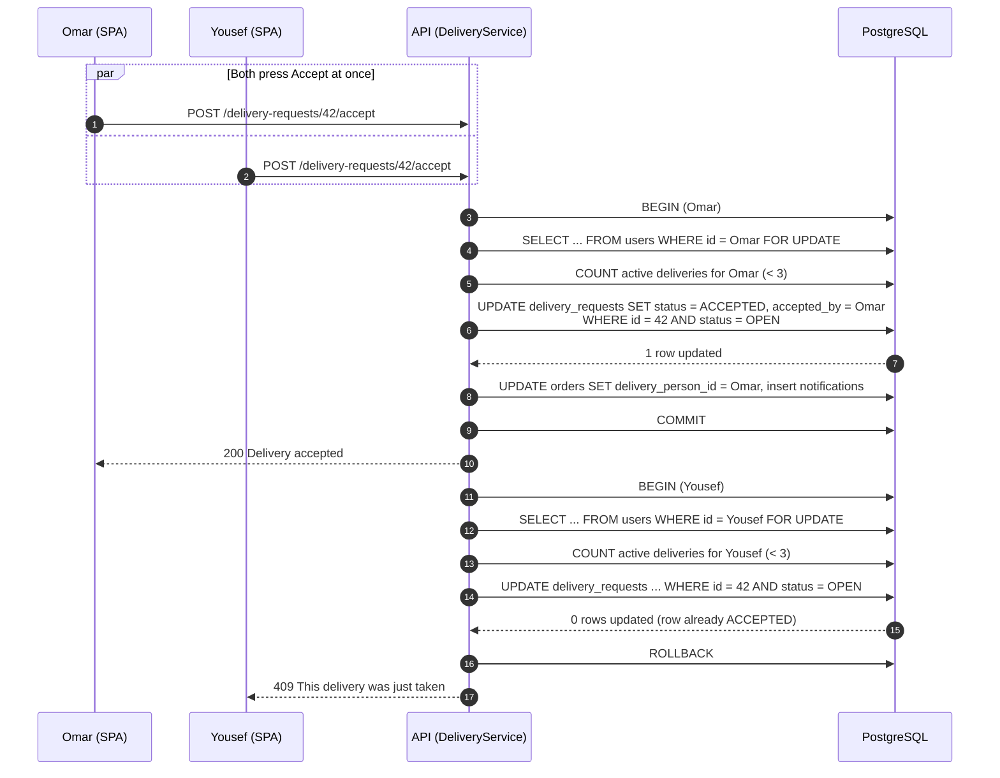

How it works:
1. **Exclusive win.** The conditional `UPDATE ... WHERE status = 'OPEN'` is atomic in PostgreSQL. The second transaction waits on the row lock, re-checks the condition after the first commits, finds `ACCEPTED`, and updates 0 rows. 0 rows means 409.
2. **Active-delivery limit.** Locking the delivery person's own `users` row (`FOR UPDATE`) serializes that person's accept calls, so two quick taps on two different requests cannot both pass the "fewer than 3" check.
3. **One transaction.** Request status, order assignment and notifications commit together or not at all.
4. **Verified by test.** An integration test (WebApplicationFactory and Testcontainers PostgreSQL) fires two accept calls in parallel and asserts one 200 and one 409.

## 9. Order Placement and Idempotency

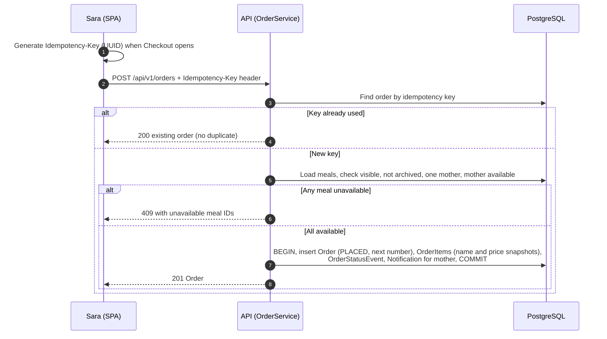

- Totals are computed on the server: `subtotal = Σ unitPrice × quantity`, `total = subtotal + DELIVERY_FEE_MINOR`. Prices sent by the client are ignored.
- A `UNIQUE` index on `orders.idempotency_key` backs up the lookup: if two identical requests race, the second insert fails and the API returns the first order.
- Order numbers come from a PostgreSQL sequence starting at 1000.
- All money is stored as integers in minor units.

## 10. Meal Photo Upload

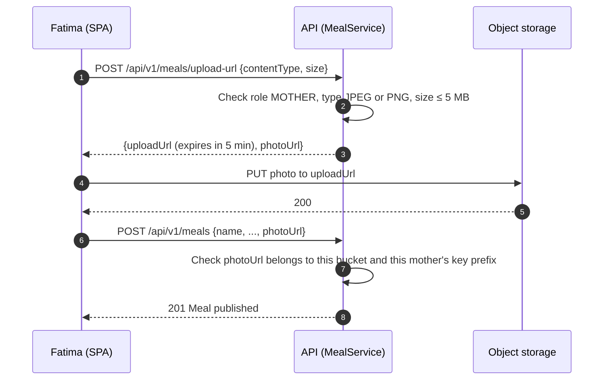

Object keys follow `meals/{motherId}/{uuid}.{ext}`. The API never streams photo bytes, so photo traffic does not load the API. If the upload fails, the meal is saved with the placeholder image (PRD P0-F002, A1).

## 11. Data Model

Tables use snake_case names through EF Core naming conventions. All IDs are UUIDs except the human-readable order number.

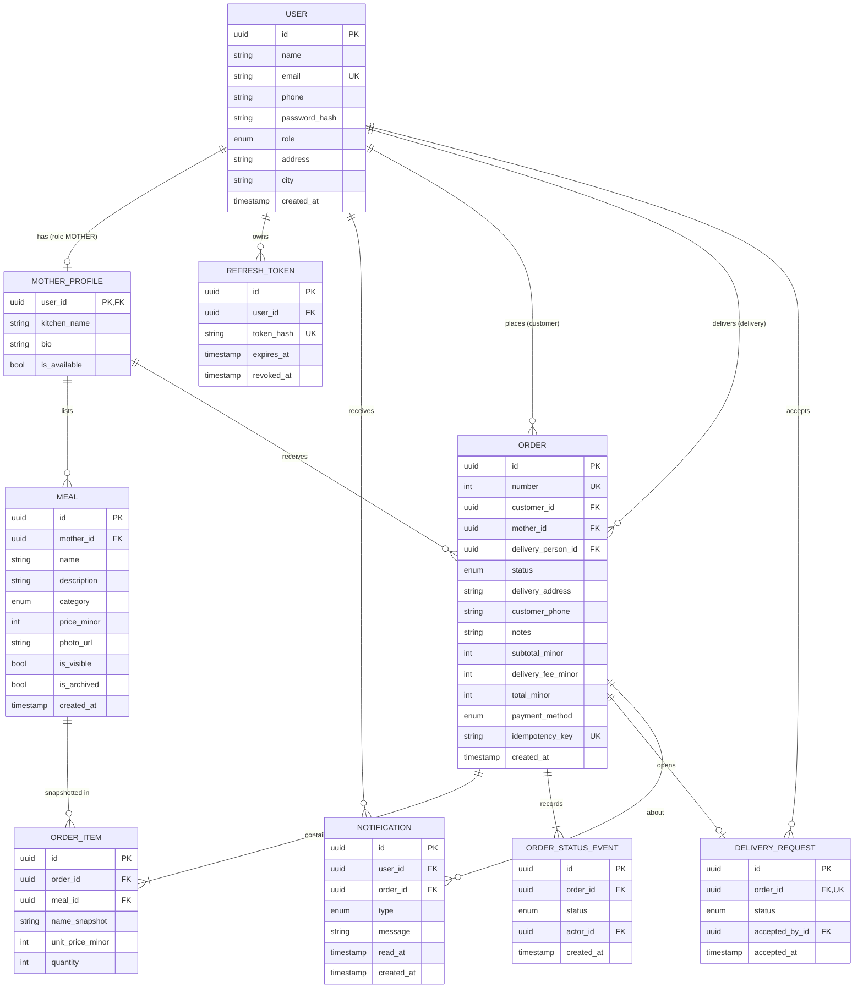

### Indexes and constraints

| Table | Index or constraint | Serves |
|---|---|---|
| users | `UNIQUE (email)` | Duplicate registration check (409) |
| meals | `(is_visible, is_archived, category, price_minor)` and a trigram index on `name` | Browse, search and filters (P0-F003, P1-F001) |
| meals | `(mother_id)` | My Meals |
| orders | `UNIQUE (idempotency_key)`, `UNIQUE (number)` | Idempotent placement, order numbers |
| orders | `(customer_id, created_at DESC)`, `(mother_id, status)`, `(delivery_person_id, status)` | Order history, incoming orders, active-delivery count |
| delivery_requests | `UNIQUE (order_id)`, `(status)` | One request per order, Available Deliveries |
| notifications | `(user_id, read_at, created_at DESC)` | Bell unread count and list |
| refresh_tokens | `UNIQUE (token_hash)` | Refresh lookup |

Check constraints enforce `price_minor > 0`, `quantity BETWEEN 1 AND 10` and `total_minor = subtotal_minor + delivery_fee_minor`.

## 12. API Surface

All endpoints live under `/api/v1/`, return JSON, and are described in the generated OpenAPI document (`/swagger` on staging only). The full list is in PRD section 11.3; this table shows how it maps to controllers and services.

| Controller | Routes | Policy | Service | Features |
|---|---|---|---|---|
| AuthController | `POST register, login, refresh, logout`; `GET me` | Anonymous except `logout`, `me` | AuthService | P0-F001 |
| MealsController | `POST upload-url`, `POST /`, `GET mine`, `PATCH {id}` | MotherOnly | MealService | P0-F002 |
| MealsController | `GET /`, `GET {id}` | CustomerOnly | MealService (cached) | P0-F003, P1-F001 |
| OrdersController | `POST /` | CustomerOnly | OrderService | P0-F003 |
| OrdersController | `GET {id}`, `PATCH {id}/status`, `GET /` | Authenticated plus ownership | OrderService, OrderStateMachine | P0-F005, P1-F002 |
| DeliveryRequestsController | `GET /`, `POST {id}/accept`, `GET mine` | DeliveryOnly | DeliveryService | P0-F004 |
| NotificationsController | `GET /`, `POST {id}/read` | Authenticated | NotificationService | P1-F003 |
| MothersController | `PATCH me/availability` | MotherOnly | ProfileService | P1-F004 |
| UsersController | `GET me`, `PATCH me` | Authenticated | ProfileService | P1-F005 |
| HealthController | `GET /health` | Anonymous | none | Observability |

Conventions: list endpoints take `page` and `pageSize` (default 20, maximum 50) and return `{ items, page, pageSize, total }`; errors are ProblemDetails with a `code` field the UI maps to messages; mutating endpoints that may be retried (`POST /orders`) accept an `Idempotency-Key` header.

## 13. Cross-Cutting Concerns

| Concern | Approach |
|---|---|
| Validation | FluentValidation on every request DTO; failures become 422 with field-level errors the UI shows inline |
| Caching | Browse and search results cached in Redis for 30 seconds per query; any meal change or availability toggle by a mother evicts that cache |
| Rate limiting | Failed logins: 5 per email per 15 minutes (Redis counter). General API: 100 requests per minute per user or IP (ASP.NET Core rate limiter backed by Redis) |
| Notifications | Rows written in the same transaction as the event that caused them; the SPA polls `GET /notifications` every 15 seconds |
| Logging | Built-in .NET JSON console logger with request ID, user ID and route; passwords, tokens and addresses are never logged |
| Monitoring | Railway metrics plus an uptime check on `/health`; alert when the 5xx error rate exceeds 1% over 5 minutes |
| Time | `IClock` abstraction; all timestamps stored in UTC (`timestamptz`) and displayed in local time |
| Security headers | HSTS, `X-Content-Type-Options`, strict CORS (frontend origin only), TLS 1.3 enforced by the hosts |
| Backups | Railway PostgreSQL daily backups with 30-day retention; restore tested once before launch |

## 14. CI/CD Pipeline

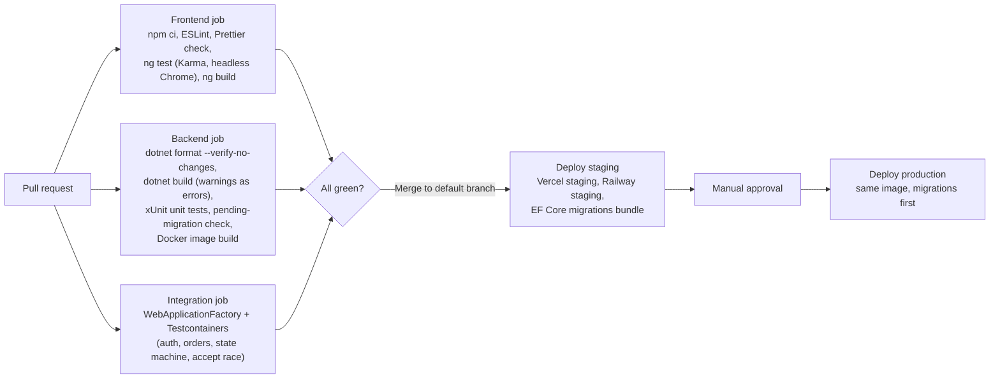

- Workflows are path-filtered: `frontend/**` changes run the frontend job, `backend/**` changes run the backend jobs.
- Database migrations run as an EF Core migrations bundle before the new API version starts. Migrations are additive first (add column, deploy, then remove old column in a later release) so a rollback never meets an incompatible schema.
- The Docker image built for staging is the same image promoted to production.

## 15. Repository Structure

```
home-to-home/
├── .github/
│   └── workflows/
│       ├── frontend.yml              # lint, typecheck, test, build, deploy to Vercel
│       └── backend.yml               # format, build, unit and integration tests, deploy to Railway
├── .specify/                         # spec-kit memory, templates and constitution
├── specs/                            # spec-kit feature folders, one per NNN-feature-name
├── docs/
│   ├── PRD.md
│   ├── ARCHITECTURE.md
│   └── speckit-commands.md
├── docker-compose.yml                # local PostgreSQL, Redis and MinIO
├── frontend/
│   ├── angular.json
│   ├── package.json
│   ├── proxy.conf.json               # ng serve: /api → http://localhost:5080
│   ├── vercel.json                   # SPA rewrite to index.html
│   ├── karma.conf.js                 # headless Chrome launcher for CI
│   ├── eslint.config.js
│   └── src/
│       ├── main.ts
│       ├── index.html
│       ├── styles.css                # Tailwind entry and design tokens
│       ├── environments/             # apiUrl, currency
│       └── app/
│           ├── app.config.ts         # router, HttpClient + interceptors, session restore
│           ├── app.routes.ts         # public, customer, mother and delivery route groups
│           ├── core/
│           │   ├── auth/             # AuthService, authGuard, roleGuard, auth interceptor
│           │   └── api/              # ProblemDetails type, field-error mapping
│           ├── features/
│           │   ├── auth/             # landing, sign-up, login pages
│           │   ├── meals/            # my-meals page, meal-form page, MealsApi
│           │   ├── customer/         # browse page (Phase 2: meal detail, cart, checkout)
│           │   └── delivery/         # available-deliveries page (Phase 2: my deliveries)
│           │       # orders, notifications and profile folders arrive in Phases 2 and 3;
│           │       # each feature folder holds its components, API service, types and *.spec.ts
│           └── shared/
│               ├── ui/               # button, field, dialog, toast, empty-state, error-banner, skeleton, header
│               └── lib/              # formatMoney
└── backend/
    ├── HomeToHome.sln
    ├── Directory.Build.props         # nullable enabled, warnings as errors, analyzers, XML docs
    ├── Dockerfile
    ├── src/
    │   ├── HomeToHome.Api/
    │   │   ├── Program.cs            # DI composition, middleware pipeline
    │   │   ├── Controllers/          # Auth, Meals, Orders, DeliveryRequests, Notifications, Mothers, Users, Health
    │   │   ├── Authorization/        # policies and role constants
    │   │   ├── Middleware/           # RequestId, ExceptionToProblemDetails
    │   │   └── appsettings.json
    │   ├── HomeToHome.Application/
    │   │   ├── Abstractions/         # IAppDbContext, ITokenService, IPhotoStorage, IRateLimiter, IClock, ICurrentUser
    │   │   ├── Auth/                 # AuthService, DTOs, validators
    │   │   ├── Meals/                # MealService, DTOs, validators
    │   │   ├── Orders/               # OrderService, OrderStateMachine, DTOs, validators
    │   │   ├── Deliveries/           # DeliveryService, DTOs
    │   │   ├── Notifications/        # NotificationService, DTOs
    │   │   ├── Profiles/             # ProfileService, DTOs, validators
    │   │   └── Common/               # domain error mapping, paging
    │   ├── HomeToHome.Domain/
    │   │   ├── Entities/             # User, MotherProfile, Meal, Order, OrderItem, OrderStatusEvent, DeliveryRequest, Notification, RefreshToken
    │   │   ├── Enums/                # Role, MealCategory, OrderStatus, DeliveryRequestStatus, NotificationType, PaymentMethod
    │   │   └── Errors/               # NotFound, Forbidden, Conflict, Validation
    │   └── HomeToHome.Infrastructure/
    │       ├── Persistence/          # AppDbContext, entity configurations, Migrations/
    │       ├── Auth/                 # JwtTokenService, refresh token hashing
    │       ├── Storage/              # S3PhotoStorage
    │       ├── Caching/              # RedisBrowseCache, RedisRateLimiter
    │       └── DependencyInjection.cs
    └── tests/
        ├── HomeToHome.UnitTests/         # services, state machine, validators, controllers (xUnit)
        └── HomeToHome.IntegrationTests/  # WebApplicationFactory + Testcontainers PostgreSQL
```

## 16. Key Decisions

| ID | Decision | Reason | Alternative not chosen |
|---|---|---|---|
| AD-01 | Modular monolith: one API with four projects | Smallest thing that keeps business rules separate from HTTP and storage; fits an 8-week, 4-person team | Microservices (operational cost with no v1 benefit) |
| AD-02 | Services use EF Core `DbContext` directly, no generic repositories | EF Core already provides unit of work and repositories; fewer layers to document and test | Repository per entity |
| AD-03 | Atomic accept through a conditional UPDATE plus a row lock on the delivery person | Correct under concurrency across multiple API instances, with no extra infrastructure | Redis distributed lock (extra failure mode) |
| AD-04 | Polling every 15 seconds for status and notifications | Meets the PRD's 15-second requirement with plain HTTP; no connection state on the API | SignalR or WebSockets (deferred to v2 with live tracking) |
| AD-05 | Photos uploaded directly to object storage with pre-signed URLs | Photos survive redeploys on Railway; API does not carry file traffic | Local disk on the API container (lost on redeploy) |
| AD-06 | Refresh token in an HttpOnly cookie, access token in memory | Refresh token cannot be read by scripts; short access token limits exposure | Both tokens in localStorage |
| AD-07 | Angular 20 with signals and RxJS polling for server state | Requested by the owner; signals cover component state and `timer` + `switchMap` covers the 15-second polling without an extra library | React 18 with TanStack Query (the v1.0 draft); NgRx (more ceremony than the MVP needs) |
| AD-08 | Notifications written in the same transaction as their event | No event bus or outbox needed; a notification never exists for a change that rolled back | Message queue |

## 17. Revision History

| Version | Date | Author | Changes |
|---|---|---|---|
| v1.0 | 2026-10-18 | Rana | Initial architecture created from PRD v1.0 |
| v1.1 | 2026-10-18 | Rana | Frontend changed from React 18 to Angular 20 (sections 1, 3, 5, 14, 15 and AD-07); local Redis is optional, with an in-memory login limiter fallback |
